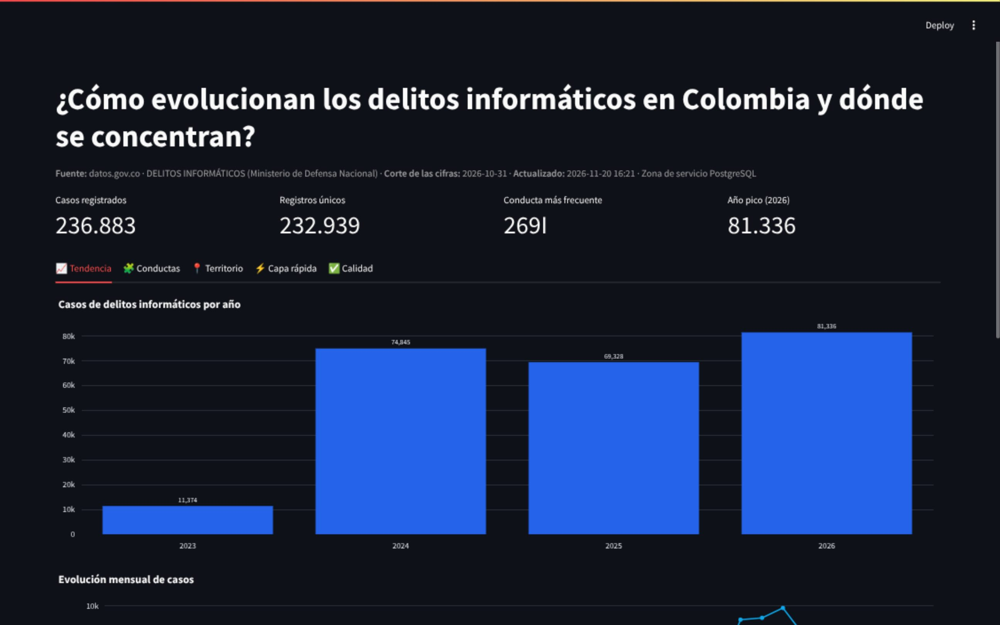
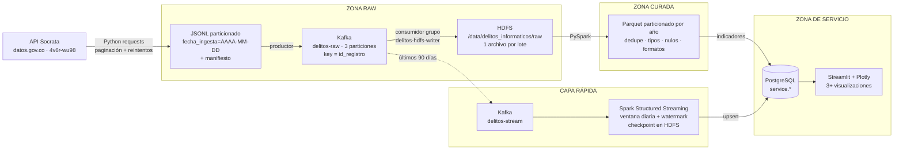

# Delitos informáticos en Colombia — pipeline de datos masivos

**Curso:** Gestión de Datos Masivos · G002 · Unidad 3
**Institución Universitaria Pascual Bravo** · Docente: Aleixo Eder Pineda Ramirez · 2026-2
**Grupo:** G002 — _(completar apellidos de los integrantes)_

> **Pregunta del proyecto:** ¿cómo evolucionan los delitos informáticos en Colombia
> entre 2023 y 2026 y en qué conductas y territorios se concentran?

| | |
|---|---|
| **Fuente** | [DELITOS INFORMÁTICOS — datos.gov.co](https://www.datos.gov.co/Seguridad-y-Defensa/DELITOS-INFORM-TICOS/4v6r-wu98/about_data) · API Socrata |
| **Entidad** | Ministerio de Defensa Nacional — MinDefensa |
| **Licencia** | Creative Commons Attribution-ShareAlike 4.0 |
| **Ventana analizada** | 2023-11-01 a 2026-10-31 (últimos 3 años del dataset) |
| **Registros** | **232.939** registros → **236.883** casos (`cantidad`) |
| **Cobertura** | 33 departamentos · 1.018 municipios · 10 conductas (art. 269A–269J) |
| **Arquitectura** | **Lambda** (capa batch + capa rápida, unidas en la zona de servicio) |
| **Tablero** | Streamlit + Plotly (sin Power BI) → <http://localhost:8501> |



---

## 1. Fuente, pregunta y usuarios

El dataset publica **un registro por caso** de delito informático con fecha del hecho,
departamento, municipio, la conducta tipificada (Título VII BIS del Código Penal,
artículos 269A a 269J) y la cantidad de casos. Se consulta por la API de Socrata
(`https://www.datos.gov.co/resource/4v6r-wu98.json`) con paginación, filtros y agregaciones.

**Pregunta principal:** ¿cómo evolucionan los delitos informáticos en Colombia entre
2023 y 2026 y en qué conductas y territorios se concentran?

**Usuarios de los indicadores**

- **Ministerio de Defensa / Policía Judicial (DIJIN, SIJIN):** priorizar campañas y
  recursos por conducta y departamento.
- **Fiscalía y ColCERT:** seguimiento de modalidades (hurto por medios informáticos,
  violación de datos personales, suplantación de sitios web).
- **Alcaldías y gobernaciones:** comparar su territorio con el resto del país.
- **Academia y ciudadanía:** entender una problemática creciente con datos abiertos.

### `id_registro`

El dataset **no publica una llave natural**: es una tabla de casos y varias filas pueden
ser idénticas en todos sus campos sin ser el mismo hecho (dos víctimas el mismo día, en
el mismo municipio, por el mismo artículo). En la ventana hay **120.115 filas con contenido
idéntico** que son casos distintos; un hash de todos los campos habría eliminado la mitad
de los casos.

Por eso el `id_registro` es el **`:id` de fila de Socrata** (`row-zier~fukf~frge`, …),
único y estable para el dataset. El sobre conserva además `hash_contenido` (hash de todos
los campos) para auditar filas idénticas sin confundirlas con duplicados del pipeline.
Si algún día la API no entregara `:id`, `construir_id_registro()` cae a ese hash.

```json
{
  "fuente": "datos.gov.co",
  "dataset": "4v6r-wu98",
  "id_registro": "row-zier~fukf~frge",
  "id_fuente": "row-zier~fukf~frge",
  "hash_contenido": "3f0c…",
  "fecha_ingesta": "2026-11-20T16:11:07.120Z",
  "payload": { ":id": "row-zier~fukf~frge", "fecha_hecho": "2026-10-31T00:00:00.000", "...": "…" }
}
```

---

## 2. Arquitectura por zonas (Lambda)



**¿Por qué Lambda y no Kappa?**

- El histórico es **batch por naturaleza**: 232.939 registros, correcciones y recargas
  mensuales, consultas analíticas sobre Parquet y comparación con MapReduce. Recalcular
  tres años en cada corrida del flujo no aporta y encarece el proceso.
- La **capa rápida** cubre la cola reciente (90 días) con ventanas diarias, watermark y
  checkpoint, y sirve para monitoreo casi en tiempo real.
- La **zona de servicio** unifica ambas: los indicadores históricos vienen del batch y
  `service.stream_diario` de la capa rápida. El tablero lee una sola base y no calcula.
- Kappa exigiría que todo el histórico pasara por el flujo y que el almacenamiento del
  stream fuera la fuente de verdad; para este dataset mensual con Parquet curado, Lambda
  es más simple, barata y explicable.

| Zona | Tecnología | Ubicación |
|---|---|---|
| Ingesta | Python `requests`, paginación `$limit/$offset`, reintentos exponenciales | `src/ingest.py` |
| Mensajería | Apache Kafka 3.7 (KRaft), tópico de 3 particiones, key = `id_registro` | `src/kafka_*.py` |
| Data lake | HDFS 3.3.6 (namenode + datanode), WebHDFS para escritura | `src/hdfs_client.py` |
| Batch | Hadoop Streaming (mapper/reducer Python) y PySpark 3.5.1 | `src/mapreduce/`, `src/spark_curated.py` |
| Curada | Parquet particionado `anio=…` | HDFS `/data/delitos_informaticos/curated` |
| Calidad | 7 validaciones automáticas, reporte JSON/Markdown | `src/quality.py` |
| Streaming | Spark Structured Streaming, ventana de 1 día, watermark 120 días, checkpoint | `src/streaming.py` |
| Servicio | PostgreSQL 16 (esquema `service` y `control`) | `sql/init.sql` |
| Tablero | Streamlit 1.40 + Plotly | `src/dashboard.py` |
| Orquestación | scripts bash (`run_pipeline.sh`) · Airflow opcional no incluido | `run_pipeline.sh` |

---

## 3. Cómo ejecutar el pipeline

Requisitos: Docker + Docker Compose (Linux), ~10 GB de disco y 8 GB de RAM libres.
No hace falta instalar Java, Spark, Kafka ni Hadoop en el host.

```bash
git clone https://github.com/dev-plague/delitos-informaticos-colombia.git
cd delitos-informaticos-colombia

docker compose up -d --wait      # Kafka, HDFS, Spark+Jupyter, PostgreSQL, Streamlit
bash run_pipeline.sh             # fases 2 a 8 de punta a punta
```

Servicios:

| Servicio | URL / puerto |
|---|---|
| Tablero Streamlit | <http://localhost:8501> |
| JupyterLab (notebook ejecutado) | <http://localhost:8888> |
| NameNode (HDFS) | <http://localhost:9870> |
| PostgreSQL | `localhost:5435` · db/usuario/clave: `delitos` |
| Kafka | `localhost:9092` |

Comandos útiles:

```bash
bash scripts/demo_idempotencia.sh    # segunda corrida: demuestra que no duplica
bash scripts/run_mapreduce.sh        # sólo el job de MapReduce
bash scripts/run_streaming_demo.sh   # streaming + reinicio + comparación con batch
make notebook                        # ejecuta el notebook dentro del contenedor
docker compose down                  # detiene todo (conserva los volúmenes)
```

La primera corrida tarda ~5 minutos (descarga 233 mil registros y los pasa por Kafka y HDFS).

---

## 4. Las 8 fases, decisiones y resultados

### Fase 2 — Ingesta a la zona raw

`src/ingest.py` descarga la API con `$limit=50000`, `$offset`, orden estable `:id` y
`$where` por fecha. Si el API responde 429/5xx o hay timeout, reintenta hasta 5 veces con
espera exponencial. Cada registro se guarda en un sobre JSON con la fuente, el dataset,
`id_registro`, `fecha_ingesta` y el `payload` original intacto, en JSON Lines particionado
por `fecha_ingesta=AAAA-MM-DD` (un archivo por página).

Cada corrida escribe un **manifiesto** (`data/raw/_manifests/`) con URL, parámetros,
conteo, rango de fechas, bytes y duración; se copia también a HDFS. La muestra de 1.000
líneas queda versionada en `data/muestra_raw.jsonl`.

**Resultado:** 232.939 registros en 5 páginas, 113 MB, ~58 s.

### Fase 3 — Mensajería con Kafka

- Tópico `delitos-raw` con **3 particiones** (también `delitos-stream`).
- Productor: `key = id_registro`, `acks=all`, compresión gzip, `max_in_flight=1`.
  Publicó **232.939 mensajes** en ~20 s.
- Consumidor: grupo `delitos-hdfs-writer`, confirma offsets **después** de escribir el
  lote (at-least-once).

**¿Qué pasa si el productor se ejecuta dos veces?** Los mensajes se reinyectan con la
misma key y el mismo `id_registro`. Kafka los distribuye a la misma partición, pero no
los deduplica. El pipeline los elimina en la zona curada con `dropDuplicates("id_registro")`
y, en la zona de servicio, con `ON CONFLICT`/`TRUNCATE+INSERT`. La demostración de la
fase 6 lo comprueba con conteos: 130 registros reinyectados → 130 duplicados eliminados
→ mismas 232.939 filas.

### Fase 4 — HDFS y MapReduce

Estructura real en HDFS:

```
/data/delitos_informaticos/
├── raw/fecha_ingesta=2026-11-20/lote-20261120T161231-00000.jsonl … (47 lotes)
├── curated/anio=2023 … anio=2026/part-*.parquet
├── mapreduce/conteo/part-00000
└── checkpoints/stream_diario/
```

Un archivo por lote (5.000 mensajes), no uno por mensaje. El job de Hadoop Streaming
(`src/mapreduce/mapper.py` y `reducer.py`) suma casos por conducta, departamento y año.
El mismo cálculo en Spark se compara clave por clave:

> **48 claves comparadas · 0 diferencias · total de filas 232.939**
> (`evidencias/mapreduce_vs_spark.md`)

### Fase 5 — Zona curada con PySpark

`src/spark_curated.py` lee el JSONL de HDFS, valida y escribe Parquet particionado por
`anio`. Decisiones y antes/después:

| Problema | Filas | Decisión |
|---|---:|---|
| Nulos en columnas clave | 0 | Se descartan: no se puede reconstruir el hecho |
| Duplicados por `id_registro` | 0 (130 en la 2.ª corrida) | Se conserva la primera aparición |
| `cantidad` fuera de rango | 0 | Se exige 1 ≤ cantidad ≤ 1.000 |
| Fechas fuera de rango | 0 | Entre 2000-01-01 y hoy |
| Códigos DANE inválidos | 0 | `cod_depto` de 2 dígitos y `cod_muni` de 5 |
| Contenido idéntico **conservado** | 120.115 | Son casos distintos, no duplicados |

**Partición `anio`:** el tablero y las consultas filtran por año, la cardinalidad es baja
(4 carpetas) y se evita el problema de 1.018 carpetas de municipio.

**Tamaño:** JSONL en HDFS **113,5 MiB** → Parquet **11,7 MiB** (≈ **89,7 % menos**),
incluso después de agregar columnas derivadas.

### Fase 6 — Calidad, carga incremental e idempotencia

7 validaciones automáticas (`src/quality.py`), 3 de ellas críticas. Si una crítica falla,
el proceso termina con código 2 y `run_pipeline.sh` se detiene.

| Validación | Crítica | Fallos |
|---|---|---|
| Conteo mayor que cero | sí | 0 |
| Sin nulos en columnas clave | sí | 0 |
| Sin `id_registro` repetido | sí | 0 |
| `cantidad` entre 1 y 1.000 | no | 0 |
| Fechas en rango | no | 0 |
| Códigos DANE válidos | no | 0 |
| Conductas no vacías / código 269x | no | 0 |

**Marca de agua:** `control.etl_control.ultima_fecha` guarda la última fecha cargada
(2026-10-31). La siguiente corrida consulta `fecha_hecho >= marca` (se reprocesa el
último día para capturar correcciones) y la curaduría deduplica.

**Demostración real** (`evidencias/idempotencia_corridas.json`):

| Corrida | Registros API | Filas raw | Duplicados eliminados | Filas curadas | Casos | Zona de servicio |
|---|---:|---:|---:|---:|---:|---:|
| 1.ª | 232.939 | 232.939 | 0 | 232.939 | 236.883 | 232.939 |
| 2.ª | 130 | 233.069 | 130 | **232.939** | **236.883** | **232.939** |

### Fase 7 — Streaming: capa rápida

`src/streaming.py` lee el tópico `delitos-stream` (21.371 registros de los últimos 90
días), agrega casos por **ventana diaria** y artículo, con **watermark de 120 días** y
**checkpoint en HDFS**, y hace `upsert` en `service.stream_diario`.

Reinicio con el mismo checkpoint: los offsets continúan, el `upsert` no duplica.

| Corrida | Offsets finales | Filas | Casos |
|---|---|---:|---:|
| 1.ª (checkpoint nuevo) | `{0:7187, 1:7030, 2:7154}` | 669 | 21.371 |
| 2.ª (reinicio) | `{0:7187, 1:7030, 2:7154}` | **669** | **21.371** |

Además, el agregado del flujo coincide con el batch para las mismas fechas:
**0 diferencias** (`evidencias/streaming_reinicio.md`). Esa es la unión Lambda: el batch
manda en el histórico y el flujo en la cola reciente.

### Fase 8 — Servicio, tablero y repositorio

PostgreSQL (`sql/init.sql`) con esquema `service`:

| Tabla | Contenido | Filas |
|---|---|---:|
| `fct_delitos` | hecho curado (auditoría) | 232.939 |
| `ind_casos_anio` | casos y participación por año | 4 |
| `ind_conducta_anio` | casos por año y artículo | 37 |
| `ind_departamento_anio` | casos y ranking por año | 132 |
| `ind_municipio` | top 30 municipios | 30 |
| `ind_mensual` | serie mensual | 36 |
| `ind_kpis` | tarjetas del tablero | 1 |
| `stream_diario` | capa rápida | 669 |

El tablero **sólo consulta** estas tablas. Tiene título en forma de pregunta, fuente,
fecha de corte, 4 tarjetas y 5 pestañas (tendencia, conductas, territorio, capa rápida,
calidad) con más de 3 visualizaciones.

**Hallazgos principales:**

- **236.883 casos** en tres años, con crecimiento sostenido: 11.374 (nov–dic 2023),
  74.845 (2024), 69.328 (2025) y **81.336** (ene–oct 2026).
- **Hurto por medios informáticos (269I)** concentra **128.934 casos (54,4 %)**, seguido
  de acceso abusivo (269A, 47.325) y violación de datos personales (269F, 30.029).
- **Bogotá D.C. (72.851)**, Antioquia (32.756) y Valle del Cauca (20.919) lideran;
  el top 3 concentra el **53,4 %** de los casos del país.

---

## 5. Evidencias

| Evidencia | Archivo |
|---|---|
| Tópico Kafka y offsets del consumidor | `evidencias/kafka_topico.txt`, `evidencias/kafka_consumidor.txt` |
| Estructura y tamaños en HDFS | `evidencias/hdfs_estructura.txt`, `evidencias/hdfs_tamanos.txt` |
| Salida de MapReduce | `evidencias/mapreduce_salida.txt` |
| MapReduce vs Spark | `evidencias/mapreduce_vs_spark.md` / `.json` |
| Antes/después de la curaduría y tamaños | `evidencias/curated_metrics.md` / `.json` |
| Reporte de calidad | `evidencias/calidad_reporte.md` / `.json` |
| Idempotencia (2 corridas) | `evidencias/idempotencia_corridas.json` |
| Streaming y reinicio | `evidencias/streaming_reinicio.md`, `streaming_vs_batch.json`, `streaming_*.json` |
| Tablero | `evidencias/tablero_*.jpg` |

---

## 6. Estructura del repositorio

```
.
├── docker-compose.yml          # Kafka, namenode, datanode, Spark+Jupyter, PostgreSQL, Streamlit
├── run_pipeline.sh             # orquestador de las fases 2 a 8
├── Makefile
├── requirements.txt
├── sql/init.sql                # esquema service + control
├── config/hadoop/              # core-site.xml y hdfs-site.xml
├── docker/                     # Dockerfiles (Spark, Hadoop, Streamlit)
├── src/
│   ├── config.py  common.py  hdfs_client.py
│   ├── ingest.py               # fase 2
│   ├── kafka_admin.py  kafka_producer.py  kafka_consumer_hdfs.py   # fase 3
│   ├── mapreduce/              # fase 4 (mapper y reducer)
│   ├── compare_mapreduce.py    # fase 4 (comparación con Spark)
│   ├── spark_curated.py        # fase 5
│   ├── quality.py              # fase 6
│   ├── streaming.py            # fase 7
│   ├── load_service.py         # fase 8
│   ├── dashboard.py            # tablero Streamlit
│   ├── register_run.py         # evidencia de idempotencia
│   └── compare_streaming.py    # streaming vs batch
├── notebooks/pipeline_delitos.ipynb   # fases 2-8 explicadas y ejecutadas
├── scripts/                    # MapReduce, idempotencia y streaming
├── data/
│   ├── muestra_raw.jsonl       # 1.000 líneas de la zona raw
│   ├── curated_sample.parquet  # 2.000 filas curadas
│   └── servicio/*.csv          # tablas de la zona de servicio
├── docs/arquitectura.md        # diagrama y decisiones
├── docs/presentacion.html      # 8 diapositivas para la sustentación
└── evidencias/
```

---

## 7. Decisiones y limitaciones

- **Sin Power BI:** todo corre en Linux; el tablero es Streamlit + Plotly y lee
  PostgreSQL directamente. Se puede abrir desde cualquier navegador de la red local.
- **`id_registro` técnico:** Socrata no publica llave de negocio y los casos pueden ser
  idénticos. Se usa `:id` y se documenta la limitación: si el dataset se reemplaza
  completamente, los `:id` podrían cambiar y una recarga completa crearía filas nuevas.
- **Watermark con `>=`:** se reprocesa el último día a propósito para capturar
  correcciones; la deduplicación por `id_registro` garantiza la idempotencia.
- **Un solo nodo:** el clúster es de un datanode y Spark en modo `local[*]`; el volumen
  (233 mil filas) no exige más y el objetivo es demostrar el recorrido completo.
- **MapReduce sobre raw:** cuenta los mensajes de la zona raw (incluidos los reinyectados
  en una segunda corrida). Por eso se ejecuta en la primera corrida; la comparación con
  Spark se hace sobre exactamente la misma entrada.
- **Componentes opcionales:** no se implementaron Airflow ni Hive. El pipeline se
  orquesta con `run_pipeline.sh` y la curaduría ya usa Parquet, por lo que Hive no
  aportaba al alcance entregado.

---

## 8. Integrantes

| Nombre | Rol |
|---|---|
| _(completar)_ | Ingesta, Kafka y HDFS |
| _(completar)_ | PySpark, calidad y streaming |
| _(completar)_ | Servicio, tablero y documentación |

Entrega en Classroom: `PP_G002_Apellido1_Apellido2.pdf` (o la extensión solicitada) con
el enlace al repositorio y este README.
