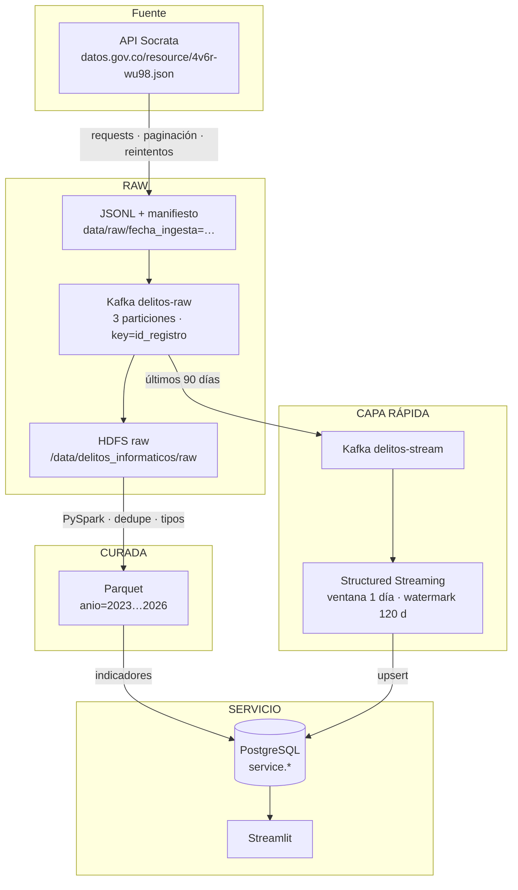

# Arquitectura del pipeline

## 1. Vista general

El pipeline recorre la fuente abierta y la transforma en tres zonas (raw → curada →
servicio) con una capa rápida en paralelo. La arquitectura es **Lambda**: la capa batch
procesa el histórico completo y la capa rápida procesa la cola reciente; ambas se unen en
PostgreSQL, que es lo único que consulta el tablero.

## 2. Flujo de un registro

1. **Ingesta.** Se pide una página de 50.000 filas al API, se envuelve cada registro en un
   sobre con `fuente`, `dataset`, `id_registro`, `fecha_ingesta` y `payload` intacto y se
   escribe una línea JSON en `data/raw/fecha_ingesta=AAAA-MM-DD/part-<run>-<n>.jsonl`.
   Al terminar se escribe el manifiesto de la corrida.
2. **Kafka.** El productor publica cada línea con `key = id_registro`. La llave asegura
   que el mismo registro siempre va a la misma partición y sirve de base para deduplicar.
3. **HDFS.** El consumidor agrupa mensajes en lotes de 5.000 y escribe un archivo por
   lote en `raw/fecha_ingesta=…/lote-<ts>-<n>.jsonl`. Confirma offsets después de escribir
   (at-least-once).
4. **Curaduría.** Spark lee todos los JSONL, valida la llave, corrige tipos (`fecha_hecho`
   a `date`, `cantidad` a `int`), normaliza textos y códigos DANE, deduplica por
   `id_registro` y escribe Parquet particionado por año.
5. **Servicio.** Spark calcula los indicadores y los carga en PostgreSQL. El tablero sólo
   consulta.

## 3. Decisiones de diseño

### 3.1 Llave del registro

El dataset no tiene llave natural. Se evaluó un hash de todos los campos, pero en la
ventana hay **120.115 filas con contenido idéntico** que corresponden a casos distintos
(dos víctimas el mismo día en el mismo municipio). Usar el hash habría eliminado el 51,5 %
de los casos. Se usa el **`:id` de Socrata**, único (232.939 distintos de 232.939 filas),
y se conserva `hash_contenido` para auditar duplicados exactos sin borrarlos.

### 3.2 Partición de la zona curada: `anio`

- El tablero y las validaciones filtran por año.
- Sólo 4 valores → 4 carpetas, escritura y lectura rápidas.
- Particionar por `departamento` (33) o `municipio` (1.018) generaría demasiados archivos
  pequeños (problema de *small files* en HDFS) sin mejorar las consultas del tablero.

### 3.3 WebHDFS en Python y HDFS nativo en Spark

La ingesta y el consumidor no necesitan el cliente Hadoop: escriben por **WebHDFS**
(HTTP) contra el namenode. Spark y Hadoop Streaming sí usan `hdfs://namenode:9000` de
forma nativa. Esto reduce imágenes y dependencias.

### 3.4 At-least-once + idempotencia

Kafka y HDFS garantizan *al menos una vez*: un fallo después de escribir y antes de
confirmar offsets puede repetir un lote. El pipeline no intenta deduplicar en el
transporte; lo hace de forma determinista en la curaduría (`id_registro`) y en el
servicio (`ON CONFLICT` / recarga transaccional). Así, correr dos veces deja el mismo
estado.

### 3.5 Marca de agua

`control.etl_control` guarda la última `fecha_hecho` cargada. La siguiente corrida pide
`fecha_hecho >= marca` (inclusive) para capturar correcciones del último día. La
curaduría elimina los repetidos. En la segunda corrida se reingresaron 130 filas y se
eliminaron 130 duplicados: los indicadores no cambiaron.

### 3.6 Streaming y Lambda

El tópico `delitos-stream` recibe los últimos 90 días. El flujo agrupa por ventana diaria
y artículo con watermark de 120 días (mayor que la ventana de la cola, para no descartar
eventos históricos que llegan juntos) y checkpoint en HDFS. El `foreachBatch` hace
`upsert` por `(fecha, codigo)`, por lo que un reinicio no duplica. La comparación con el
batch sobre las mismas fechas da **0 diferencias**.

## 4. Operación

| Acción | Comando |
|---|---|
| Levantar | `docker compose up -d --wait` |
| Pipeline completo | `bash run_pipeline.sh` |
| Segunda corrida (idempotencia) | `bash scripts/demo_idempotencia.sh` |
| Streaming + reinicio | `bash scripts/run_streaming_demo.sh` |
| Notebook | `make notebook` |
| Ver HDFS | `docker compose exec namenode hdfs dfs -ls -R /data/delitos_informaticos` |
| Ver tópico | `docker compose exec kafka /opt/kafka/bin/kafka-topics.sh --bootstrap-server localhost:9092 --describe --topic delitos-raw` |
| Logs | `docker compose logs -f --tail=50` |

## 5. Riesgos y mitigaciones

| Riesgo | Mitigación |
|---|---|
| API caída o límite de tasa | Reintentos exponenciales (5) y manifiesto con estado |
| Duplicados por reintentos | `id_registro` + dedupe en curaduría |
| Cambios en el esquema de la fuente | Esquema explícito y `payload` intacto para reprocesar |
| Pérdida de la zona de servicio | Recarga determinista desde Parquet |
| Reinicio del flujo | Checkpoint en HDFS + upsert idempotente |
| Disco insuficiente | Parquet comprime ~90 %; la muestra versionada es pequeña |
